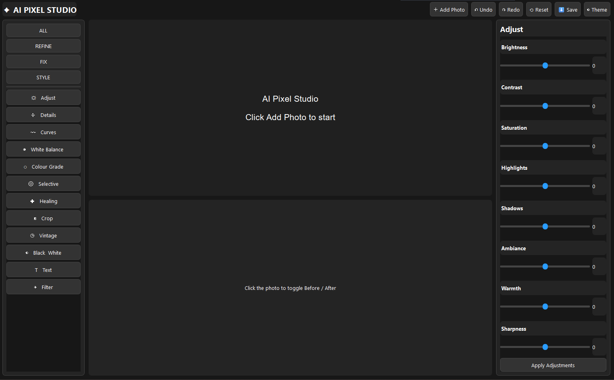

# AI Pixel Studio

## Application Screenshot



AI Pixel Studio is a Python-based desktop image editing application built with PySide6.

## Features

- Image opening and editing
- Brightness, contrast and saturation adjustment
- Color grading
- Selective editing
- Text addition
- Healing tool
- Image enhancement
- Black and white theme support

## Technologies Used

- Python
- PySide6
- Pillow
- NumPy
- OpenCV

## Installation

First, install the required libraries:

```bash
pip install -r requirements.txt
```

## Run the Application

Run the following command:

```bash
python ai_pixel.py
```

## Project Structure

```text
AI-Pixel-Studio/
│
├── ai_pixel.py
├── requirements.txt
└── README.md
```

## Developer

Developed as a Python-based image editing project.

git add README.md